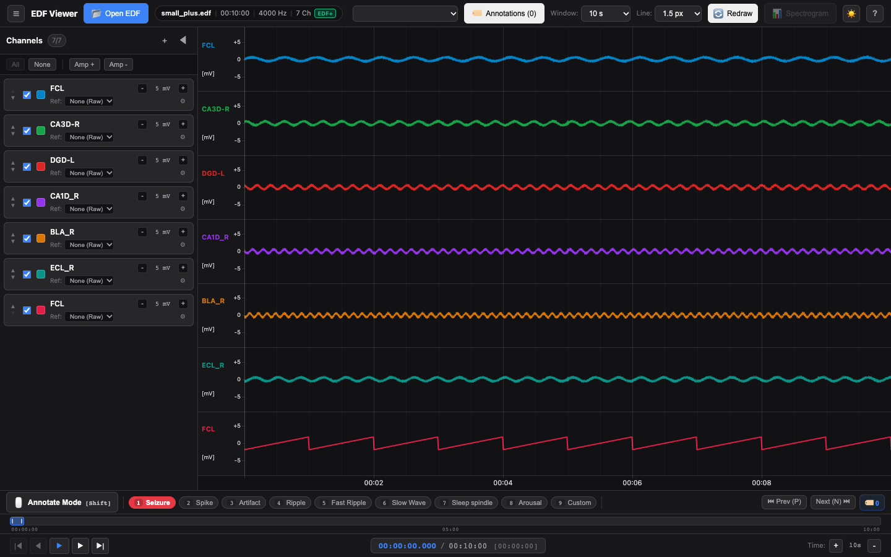
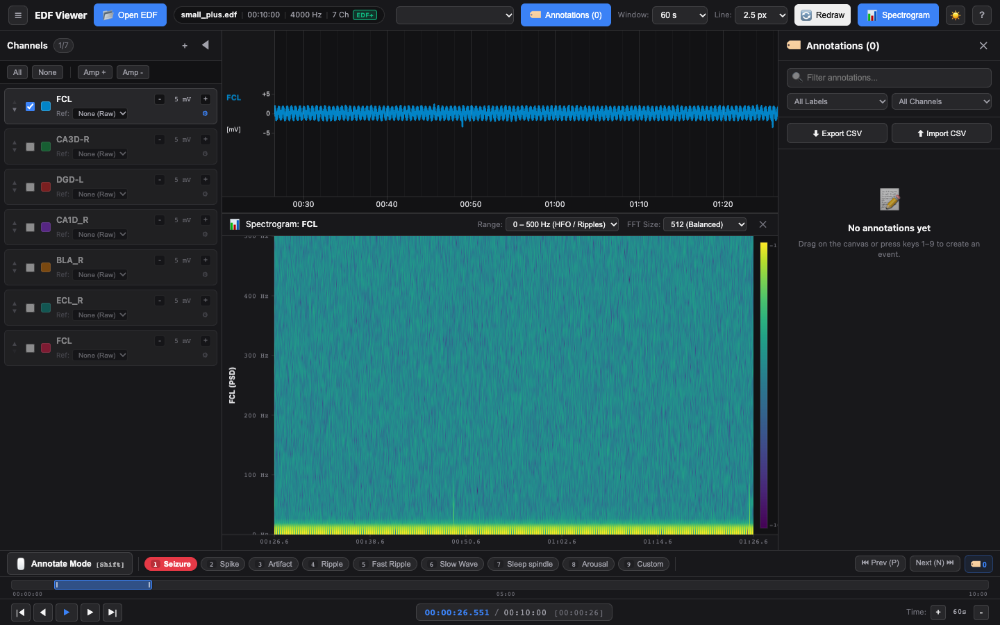
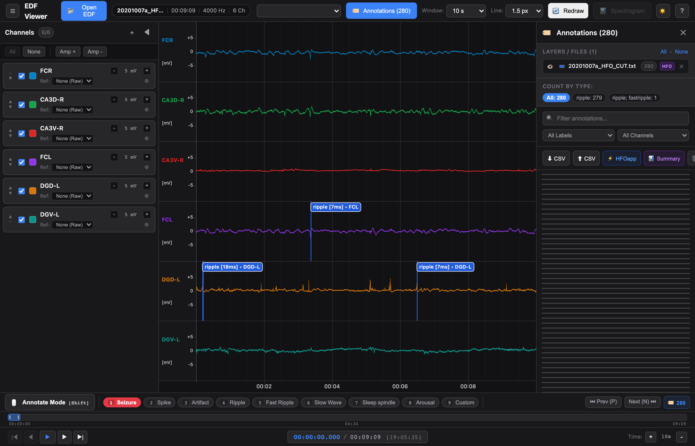
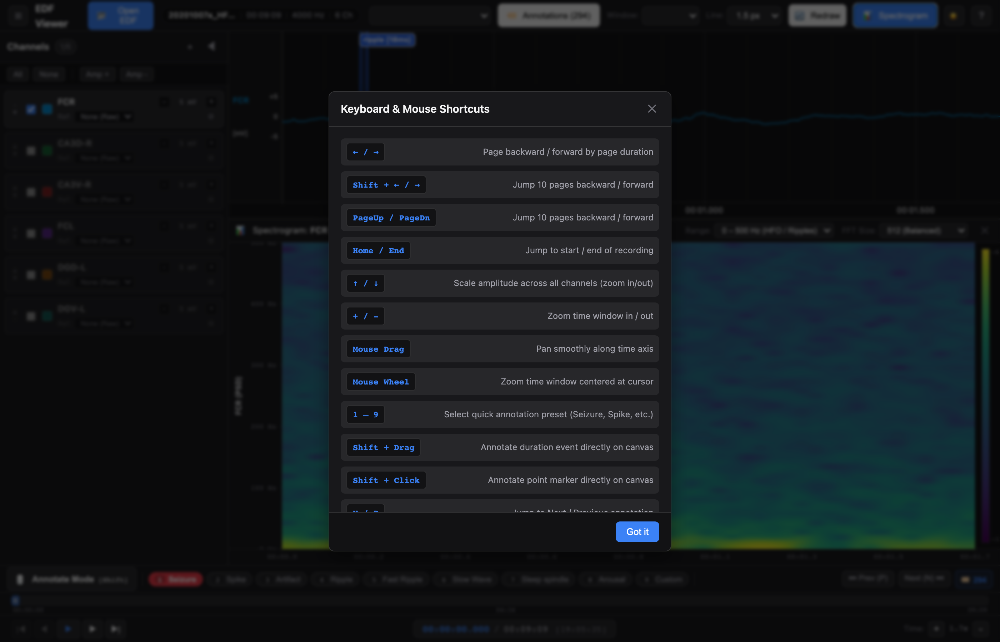
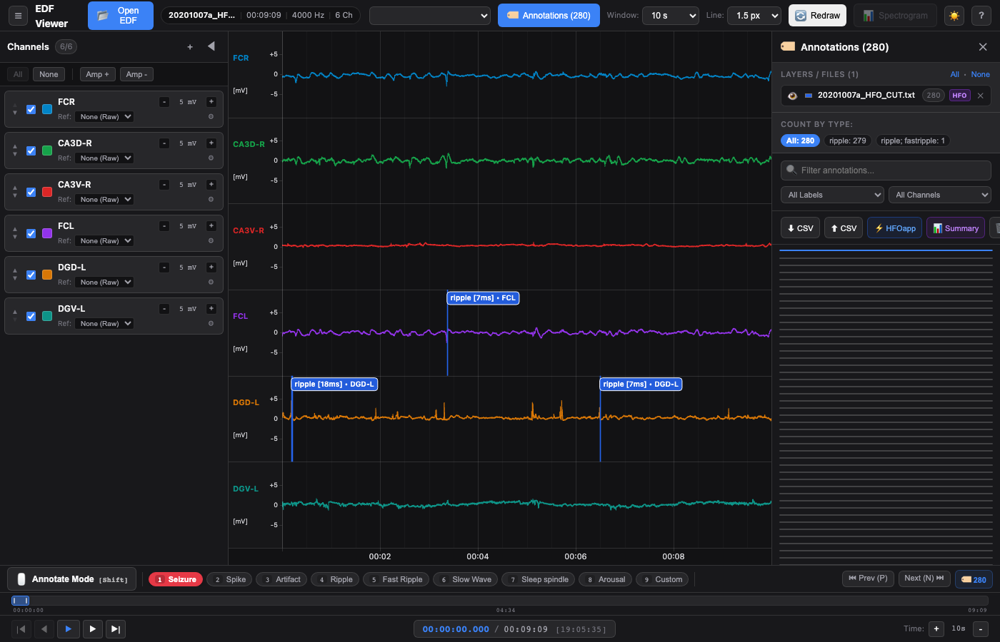
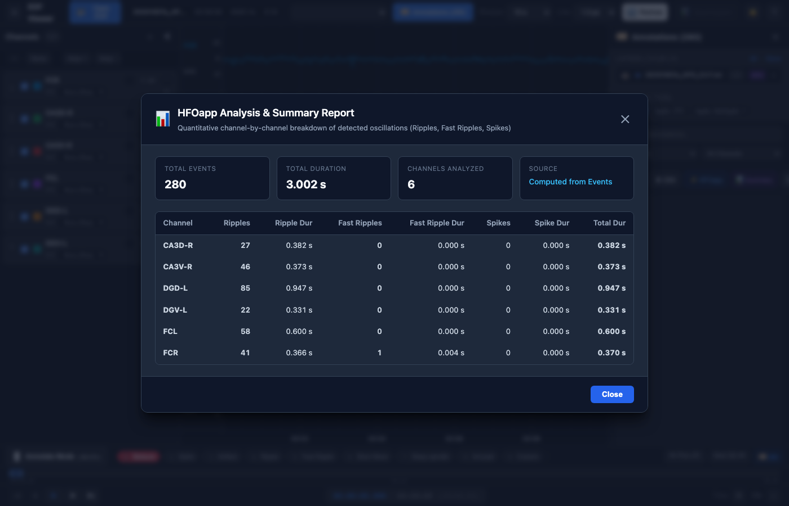

# EDF Viewer

[](https://github.com/mgiugliano/EDFviewer/actions/workflows/deploy.yml)
[](https://opensource.org/licenses/MIT)
[](https://www.rust-lang.org/)
[](https://webassembly.org/)
[](https://svelte.dev/)

An ultra-efficient, client-side web application running **Rust WebAssembly** to open, visualize, filter, analyze, and annotate very long **EDF and EDF+** recordings (such as 24-hour continuous rodent EEG recorded at 4 kHz across 7+ channels).

Multi-gigabyte recordings load seamlessly as if they were tiny files: data chunks are decoded strictly on demand directly from the local disk using `File.slice()`. **Zero data is uploaded to remote servers**, ensuring complete privacy and instantaneous responsiveness.

**Live Application**: [https://blog.giugliano.info/EDFviewer/](https://blog.giugliano.info/EDFviewer/)  
*(Alternative mirror: [https://mgiugliano.github.io/EDFviewer/](https://mgiugliano.github.io/EDFviewer/))*

---

## Visual Tour

| Multi-Channel Continuous Trace View | Split Time-Frequency Spectrogram (Viridis) |
| :---: | :---: |
|  |  |
| *Dedicated calibration gutter (±scale bars, units, zero-line), custom channel colors, smooth 60 fps panning.* | *Interactive STFT heatmap synchronized with trace, hover cursor showing exact time, frequency, and dB power.* |

| Interactive Annotations Layer & Sidebar | Keyboard Shortcuts & Lab Attribution |
| :---: | :---: |
|  |  |
| *Fast click/drag event marking, quick palettes (1–9), search filtering, CSV export/import, IndexedDB autosave.* | *Full keyboard shortcuts reference and laboratory acknowledgment.* |

| HFOapp Detections & Layer Visibility Toggles | Quantitative HFO Analysis & Detector Comparison |
| :---: | :---: |
|  |  |
| *Channel-specific HFO highlight spans (Ripples, Fast Ripples), individual layer toggle (👁️/🚫), color coding, and quick navigation.* | *Channel-by-channel breakdown table (counts, durations) and cross-detector side-by-side comparison.* |

---

## Key Highlights

- **Lazy Chunked Data Engine**: Random-access byte reading via `File.slice()` with an LRU cache budget (128 MB). Opening a 5 GB 24-hour recording takes **$< 1\text{ ms}$** and consumes under **95 MB of RAM**.
- **Hardware-Accelerated WebGL2 Traces**: Multi-channel trace lanes rendered via GPU vertex shaders with subpixel multi-pass anti-aliasing and configurable line thickness (1.0 to 3.0 px).
- **Multi-Level Overview Pyramid**: Streaming min/max decimation hierarchy built in the background and cached in IndexedDB (~25 MB for a 24-hour file).
- **Time-Frequency Spectrogram (STFT)**: Instant single-channel spectrogram with Hann windowing, customizable frequency range (e.g. 0–500 Hz for rodent HFOs / ripples, or full Nyquist), FFT size (256, 512, 1024), and hover inspection.
- **Zero-Phase Digital Filtering**: Causal & anti-causal Butterworth filters (High-pass, Low-pass, Band-pass) and 50/60 Hz Notch filters evaluated via Second-Order Sections (SOS) matching `scipy.signal` within $10^{-15}$.
- **Flexible Montages & Derivations**: Channel visibility toggling, amplitude re-scaling, polarity inversion, bipolar re-referencing ($V_a - V_b$), and exportable JSON montage presets.
- **Non-Blocking Annotation Suite**: Click-and-drag or single-click point marking without interruption, quick presets (Seizure, Spike, Artifact, Sleep, etc.), bidirectional navigation (`N`/`P`), and full CSV import/export.
- **HFOapp & Detector Clone Integration**: Direct drag-and-drop or file import of HFOapp `.txt` and `_summary.txt` reports. Individual layer visibility toggles (`👁️`/`🚫`), customizable layer colors, and cross-detector side-by-side comparison analytics.
- **Total Data Privacy**: 100% of the computations, signal processing, and rendering occur locally inside the browser. No telemetry or file transmission ever takes place.

---

## Mathematical Formulations

### 1. Digital Filtering Architecture

Signal filtering is implemented in Rust (`core/src/filter.rs`) and executed in WebAssembly using cascaded **Second-Order Sections (SOS)** to prevent numeric coefficient quantization instabilities:

$$H(z) = g \prod_{k=1}^K \frac{b_{0k} + b_{1k} z^{-1} + b_{2k} z^{-2}}{1 + a_{1k} z^{-1} + a_{2k} z^{-2}}$$

#### Bilinear Transform Warping
Analog prototype poles are mapped to discrete digital frequencies using pre-warping:

$$\Omega = 2 f_s \tan\left(\frac{\pi f_c}{f_s}\right)$$

where $f_c$ is the cutoff frequency and $f_s$ is the sampling rate in Hertz.

#### Mains Hum Notch Filter
The notch filter eliminates 50 Hz or 60 Hz electrical interference using a zero-pole pair with quality factor $Q$:

$$H_{\text{notch}}(z) = \frac{1 - 2\cos(\omega_0) z^{-1} + z^{-2}}{1 - 2 r \cos(\omega_0) z^{-1} + r^2 z^{-2}}$$

where:
$$\omega_0 = \frac{2\pi f_0}{f_s}, \quad \text{Bandwidth } BW = \frac{f_0}{Q}, \quad r = 1 - \frac{\pi \cdot BW}{f_s}$$

#### Zero-Phase Forward-Backward Filtering (`filtfilt`)
To eliminate phase distortion and preserve peak latencies critical for electrophysiology, the signal is filtered forward, time-reversed, filtered again, and time-reversed:

$$y[n] = x[n] * h[n] \implies Y(\omega) = X(\omega) \cdot |H(\omega)|^2, \quad \angle Y(\omega) = 0$$

Boundary transient artifacts are mitigated using reflected odd Gustafsson edge padding:

$$x_{\text{pad}} = [2x[0] - x[N_p \dots 1], \quad x[0 \dots N-1], \quad 2x[N-1] - x[N-2 \dots N-1-N_p]]$$

---

### 2. Short-Time Fourier Transform (STFT) & Spectrogram

The spectrogram evaluates localized frequency content over sliding windows:

$$X(m, k) = \sum_{n=0}^{N-1} x[m \cdot H + n] \cdot w[n] \cdot e^{-j \frac{2\pi}{N} k n}, \quad k = 0, 1, \dots, \frac{N}{2}$$

where:
- $N$ is the FFT window size (default $N = 512$ or $1024$).
- $H$ is the hop size (default $H = N/4$, representing 75% overlap).
- $w[n]$ is the symmetric **Hann window** minimizing spectral leakage:

$$w[n] = 0.5 \left(1 - \cos\left(\frac{2\pi n}{N - 1}\right)\right)$$

#### Power Spectral Density (PSD) in Decibels
Power spectral density normalized by the window energy is converted to logarithmic decibels (dB):

$$P_{\text{norm}}(m, k) = \frac{|X(m, k)|^2}{\left(\frac{1}{2} N\right)^2}$$

$$P_{\text{dB}}(m, k) = 10 \log_{10} \left(P_{\text{norm}}(m, k) + 10^{-12}\right)$$

#### Frequency Calibration
Each bin $k$ directly maps to physical frequency:

$$f_k = k \cdot \frac{f_s}{N} \quad \text{for } k \in \left[0, \frac{N}{2}\right]$$

The matrix is rasterized to an offscreen image and mapped via the **Viridis** colormap, utilizing GPU bilinear interpolation for 60 fps rendering.

---

## Tutorial Appendix

### Step 1: Opening a File
1. Visit [https://blog.giugliano.info/EDFviewer/](https://blog.giugliano.info/EDFviewer/) in Chrome, Edge, Safari, or Firefox.
2. Click **📂 Open EDF** in the top-left toolbar, or drag and drop any `.edf` / `.rec` file anywhere onto the browser window.
3. The recording duration, primary sampling rate, channel count, and EDF+ indicator will appear in the top metadata pill.

### Step 2: Navigating the Recording
- **Smooth Panning**: Click and drag horizontally across the traces to glide through time.
- **Page Flipping**: Use the `←` / `→` arrow keys (or the `◀` / `▶` buttons in the bottom scrubber bar). Press `Shift + ← / →` or `PageUp / PageDown` to jump 10 pages.
- **Window Zoom**: Choose standard page durations from the **Window** selector (`1s`, `5s`, `10s`, `30s`, `60s`, `5m`, `15m`, `1h`) or press `+` and `-`.
- **Go To Timestamp**: Press `G` to open the timestamp jump dialog and enter a target second or `HH:MM:SS`.
- **Continuous Auto-Scroll**: Press `Spacebar` to toggle smooth playback.

### Step 3: Configuring Channels & Montages
- **Toggle Channels**: Click the checkbox next to any channel name in the left sidebar to show or hide it.
- **Adjust Amplitude Scale**: Click `+` or `-` on any channel card to zoom voltage in or out, or press `↑` / `↓` to scale all channels simultaneously.
- **Line Thickness**: Select `1.0 px`, `1.5 px`, `2.0 px`, `2.5 px`, or `3.0 px` from the **Line** dropdown in the toolbar.
- **Bipolar Derivation**: Click **+ Add Bipolar Derivation** in the sidebar to compute differential signals ($V_A - V_B$).
- **Save Montage**: Save your customized channel layout, colors, and gains as a JSON preset via the Montage menu for reuse across recordings.

### Step 4: Applying Real-Time Filters
1. Click the gear icon (`⚙`) next to any channel name in the sidebar.
2. Choose from standard presets:
   - **High-pass**: `0.1 Hz`, `0.5 Hz`, `1.0 Hz`
   - **Low-pass**: `30 Hz`, `70 Hz`, `100 Hz`
   - **Notch**: `50 Hz` (Europe/Asia) or `60 Hz` (Americas)
3. Click **Apply to Channel** or **Apply to All Channels**.

### Step 5: High-Frequency Oscillation (HFO) & Spectrogram Inspection
1. In the left sidebar, uncheck other channels so that **exactly one channel is visible**.
2. Click the **`[ 📊 Spectrogram ]`** button in the toolbar (or press `S`).
3. The viewport cleanly splits into:
   - **Top 35%**: Raw/filtered trace signal.
   - **Bottom 65%**: High-resolution time-frequency spectrogram heatmap.
4. Use the **Range** dropdown to zoom to `0 – 500 Hz` (ideal for ripples and fast ripples) or `0 – 100 Hz` (for local field potentials).
5. Hover anywhere on the spectrogram to view crosshairs and numerical values (`Timestamp`, `Frequency Hz`, and `Power dB`).

### Step 6: Marking & Exporting Annotations
- **Quick Presets**: Press number keys `1` through `9` to select preset labels (e.g., `1` for Seizure, `2` for Spike, `3` for Artifact).
- **Duration Marking**: Hold `Shift` and drag across any region on the canvas.
- **Point Marking**: Hold `Shift` and click at any point on the trace.
- **Browse Events**: Open the Annotations sidebar (`A`) or jump sequentially using `N` (Next) and `P` (Previous).
- **CSV Export**: Click **⬇ Export CSV** in the annotations panel to export your event log.

### Step 7: Importing HFOapp Reports & Comparing Detector Runs
1. **Importing Reports**:
   - Open your EDF file first.
   - Click **⚡ HFOapp** in the Annotations panel, or simply **drag-and-drop** any `.txt` detection report (e.g., `20201007a_HFO_CUT.txt`) or `_summary.txt` file directly onto the viewer.
   - The viewer automatically converts sample locations to exact timestamps based on channel sampling rates:
     $$\text{onset (s)} = \frac{\text{start\_sample}}{f_s}, \quad \text{duration (s)} = \frac{\text{end\_sample} - \text{start\_sample}}{f_s}$$
2. **Channel-Specific Visual Highlights**:
   - Detected events (Ripples, Fast Ripples, Spikes) are rendered directly over their respective channel lanes as translucent highlight bands with upper boundary badges.
   - Hovering over an event on the trace displays its detected frequency, peak z-score, and cycle count (e.g., `491.2 Hz | Z=13.9 | 7.6 cyc`).
3. **Multi-Layer Toggle & Comparison**:
   - Each imported report creates an independent **Layer** in the **Layers / Files** panel.
   - Click the **Eye icon (`👁️` / `🚫`)** next to any layer to toggle its visibility on and off independently.
   - This allows instant visual comparison of multiple detector runs or algorithm variants (e.g. comparing the original HFOapp detections with a newly trained clone model) on the same traces.
   - Use the color swatch next to each layer to assign distinct colors (e.g., Blue for Detector A, Purple for Detector B).
4. **Summary & Cross-Detector Metrics**:
   - Click **📊 Summary** to view the comprehensive channel-by-channel breakdown (event counts, cumulative durations) and cross-detector comparison tables.

---

## Keyboard & Mouse Shortcuts

| Key | Description |
| :--- | :--- |
| `←` / `→` | Page backward / forward by one window |
| `Shift + ← / →` | Jump 10 pages backward / forward |
| `PageUp` / `PageDown` | Jump 10 pages backward / forward |
| `Home` / `End` | Jump to start / end of recording |
| `↑` / `↓` | Scale amplitude across all visible channels |
| `+` / `-` | Zoom time window in / out |
| `Mouse Drag` | Pan smoothly along the time axis |
| `Mouse Wheel` | Zoom time window centered at mouse position |
| `1` – `9` | Select quick annotation preset (Seizure, Spike, etc.) |
| `Shift + Drag` | Draw duration annotation directly on trace |
| `Shift + Click` | Mark point annotation directly on trace |
| `N` / `P` | Jump to Next / Previous annotation |
| `S` | Toggle Spectrogram view (when 1 channel is visible) |
| `R` | Force redraw / re-query display traces |
| `A` | Toggle Annotations sidebar |
| `G` | Jump to specific timestamp (`HH:MM:SS` or seconds) |
| `Space` | Toggle continuous playback auto-scroll |
| `?` | Show keyboard shortcuts and about dialog |
| `Esc` | Close open modal dialogs |

---

## Architecture & Technology Stack

```
edf_viewer/
├── core/                       # Rust WebAssembly Core (crate: edf_core)
│   ├── src/
│   │   ├── annotations.rs      # EDF+ TAL UTF-8 annotation parser
│   │   ├── decimate.rs         # Min/Max downsampling & pyramid mipmaps
│   │   ├── decode.rs           # Fast 16-bit integer to physical float decoder
│   │   ├── filter.rs           # Butterworth & notch digital IIR SOS filter
│   │   ├── header.rs           # 256-byte header & signal header parser
│   │   ├── reader.rs           # High-level EdfReader wasm object
│   │   └── spectrogram.rs     # Radix-2 Cooley-Tukey STFT & Hann window
│   └── Cargo.toml
│
└── web/                        # Svelte 5 + TypeScript Web Application
    ├── src/
    │   ├── lib/
    │   │   ├── annotations/    # Store, IndexedDB autosaver, CSV export
    │   │   ├── components/     # UI components (Viewport, Toolbar, Spectrogram)
    │   │   ├── engine/         # Web Worker RPC client & protocol
    │   │   ├── montage/        # Montage state, derivations, JSON presets
    │   │   └── render/         # WebGL2 TraceRenderer, Overlay, Colormap
    │   ├── worker/
    │   │   └── edf.worker.ts   # Off-thread WebAssembly compute worker
    │   ├── App.svelte          # Main application orchestrator
    │   └── main.ts
    └── package.json
```

---

## Local Developer Setup

### Prerequisites
- **Rust Toolchain**: `rustup target add wasm32-unknown-unknown`
- **wasm-pack**: `cargo install wasm-pack`
- **Node.js**: Node 22+ and npm

### Build & Run
```bash
# Clone the repository
git clone https://github.com/mgiugliano/EDFviewer.git
cd EDFviewer

# Install web dependencies
cd web && npm install

# Build WebAssembly core module
npm run build:wasm

# Start local development server with hot-reload
npm run dev
```

### Running Test Suites
```bash
# Run Rust unit tests & signal processing benchmarks
cd core && cargo test

# Run frontend unit tests
cd web && npm test

# Run full end-to-end headless browser test
cd web && node smoke_test.mjs
```

---

## Attribution & Acknowledgments

**EDF Viewer v0.1**  
Developed by **M. Giugliano** and **O. Kryukova** for **G. Curia's Laboratory**.  
*November 2026.*

Released under the [MIT License](LICENSE).
