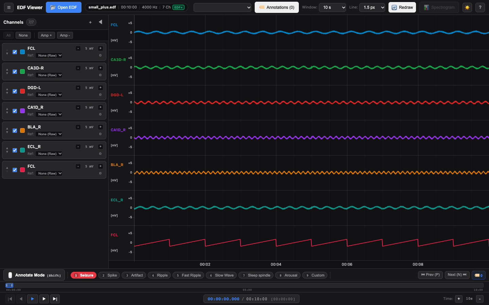
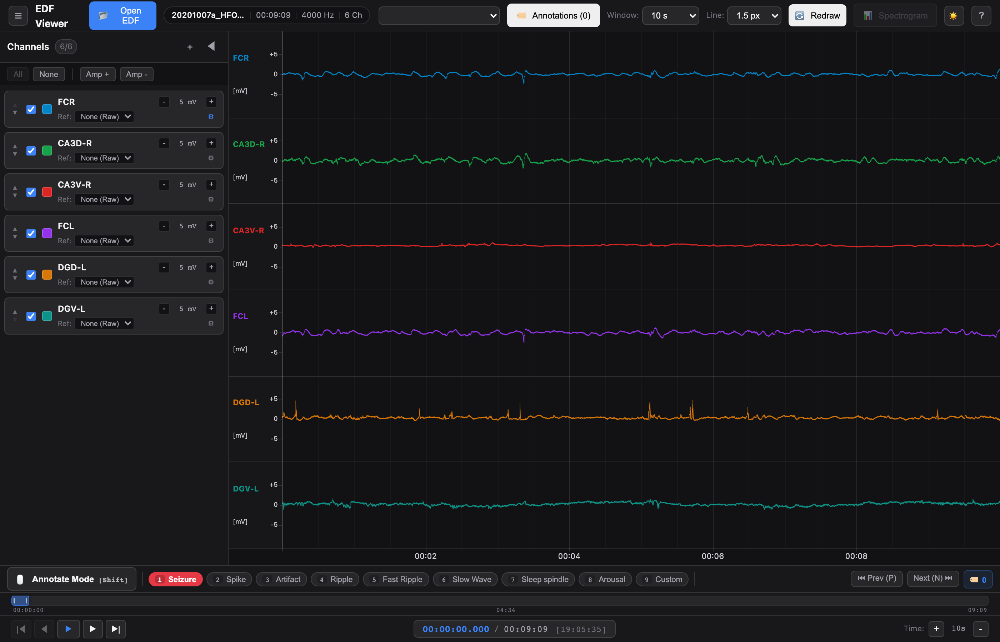
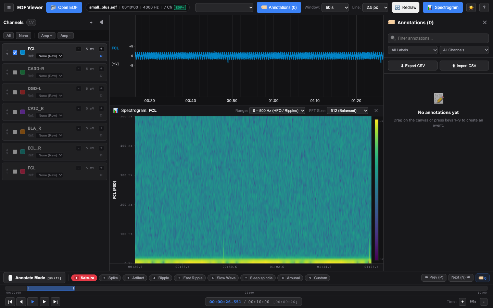
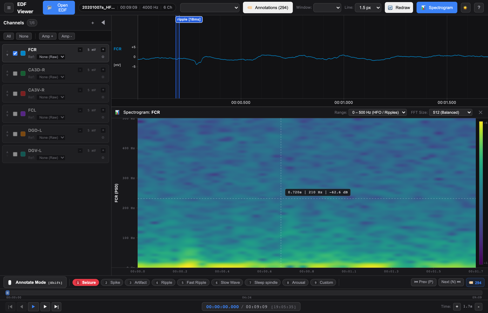
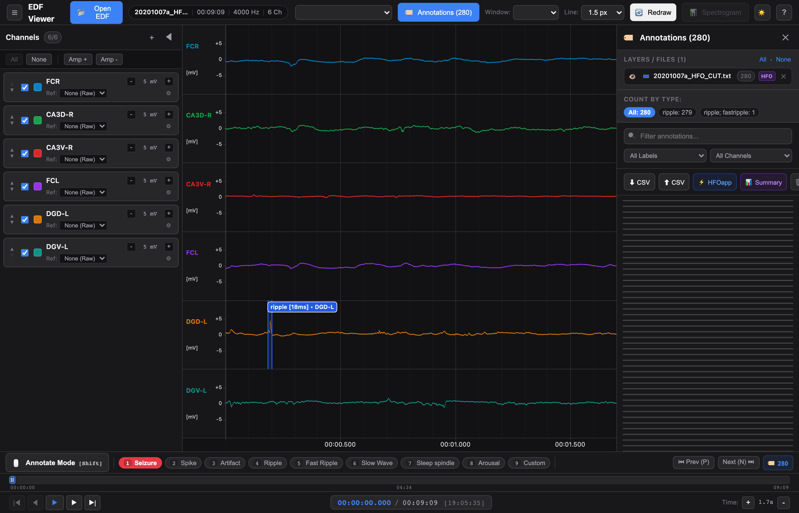
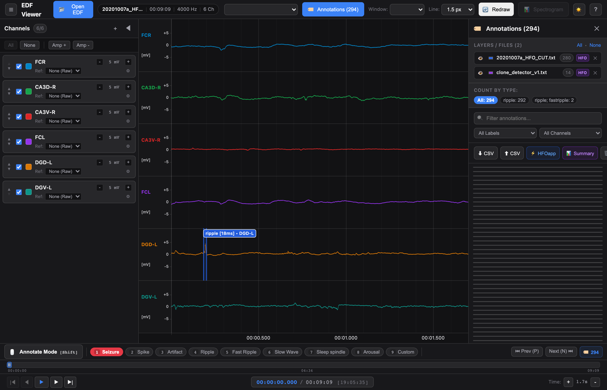
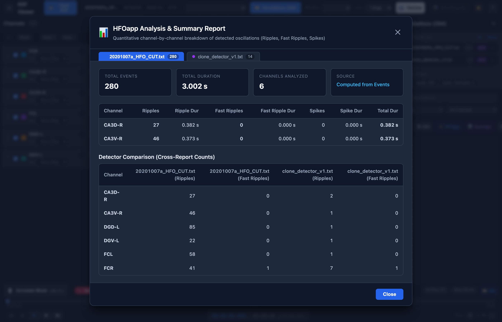
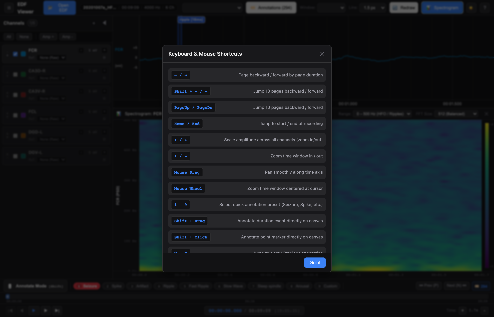
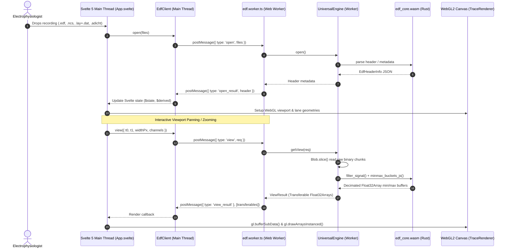

# EDF & Electrophysiology Viewer — Comprehensive Operator Manual & Technical Architecture Guide

[](https://github.com/mgiugliano/EDFviewer/actions/workflows/deploy.yml)
[](https://opensource.org/licenses/MIT)
[](https://www.rust-lang.org/)
[](https://webassembly.org/)
[](https://svelte.dev/)
[](https://developer.mozilla.org/en-US/docs/Web/API/WebGL2RenderingContext)

**Live Application**: [https://blog.giugliano.info/EDFviewer/](https://blog.giugliano.info/EDFviewer/)  
**Alternative Mirror**: [https://mgiugliano.github.io/EDFviewer/](https://mgiugliano.github.io/EDFviewer/)  
**Laboratory Attribution**: *Authored by Michele Giugliano and Olga Kryukova for Giulia Curia's Laboratory, November 2026 (version 0.2).*

---

## Executive Overview & Philosophy

The **EDF & Electrophysiology Viewer** is an ultra-high-performance, client-side web application designed for electrophysiologists, neurologists, neuroscientists, and bioengineers. It enables seamless inspection, online filtering, time-frequency spectrogram analysis, and annotation comparison for multi-gigabyte continuous recordings directly inside modern web browsers.

### Core Architectural Principles
1. **100% Client-Side Execution (Zero Remote Backend)**:
   All file parsing, decompression, filtering, and rendering occur entirely inside your browser sandbox via **Rust WebAssembly** and a dedicated **Web Worker**. No patient data or waveform bytes are ever transmitted over the network or stored on remote servers, providing strict compliance with medical confidentiality and data privacy guidelines.
2. **Instant Ingestion via Random-Access Seeking (`Blob.slice`)**:
   Whether an electrophysiology file is $50\text{ MB}$ or $20\text{ GB}$ (e.g. 24-hour continuous rodent multi-channel LFP at $4\text{ kHz}$), files open in less than $20\text{ ms}$. Data chunks are loaded strictly on demand directly from the local filesystem via asynchronous block slicing.
3. **Hardware-Accelerated WebGL2 Rendering at 60 fps**:
   Electrophysiology traces are rasterized using instanced GPU line strip shaders, maintaining smooth 60 fps frame rates during high-speed timeline scrubbing and panning.
4. **Universal Format Interoperability**:
   The engine natively ingests **EDF / EDF+ (`.edf`, `.rec`)**, **Neuralynx / Persyst Continuously Sampled (`*.ncs`)**, **Persyst Layout (`.lay` + `.dat`)**, and **ADInstruments LabChart (`.adicht`)** recordings without requiring any pre-conversion scripts.

---

## Table of Contents

- [Part I: Operator Manual (Step-by-Step User Guide)](#part-i-operator-manual-step-by-step-user-guide)
  - [1. Loading Electrophysiology Recordings](#1-loading-electrophysiology-recordings)
  - [2. Navigating Time & Scrubbing Traces](#2-navigating-time--scrubbing-traces)
  - [3. Channel Sidebar, Scale, Line & Font Controls](#3-channel-sidebar-scale-line--font-controls)
  - [4. Bipolar Derivations & Montage Presets](#4-bipolar-derivations--montage-presets)
  - [5. Online Zero-Phase Digital Filtering](#5-online-zero-phase-digital-filtering)
  - [6. High-Frequency Oscillation (HFO) & Spectrogram Analysis](#6-high-frequency-oscillation-hfo--spectrogram-analysis)
  - [7. Event Annotations & Multi-Detector Comparison](#7-event-annotations--multi-detector-comparison)
  - [8. Keyboard & Mouse Interaction Reference](#8-keyboard--mouse-interaction-reference)
- [Part II: Developer & AI Agent Technical Architecture Guide](#part-ii-developer--ai-agent-technical-architecture-guide)
  - [9. High-Level Architecture & Process Concurrency](#9-high-level-architecture--process-concurrency)
  - [10. Core Rust WebAssembly Engine (`core/`)](#10-core-rust-webassembly-engine-core)
  - [11. Mathematical Formulations (Filtering, Padding, STFT)](#11-mathematical-formulations-filtering-padding-stft)
  - [12. Multi-Format Data Ingestion Engine (`web/src/lib/engine/`)](#12-multi-format-data-ingestion-engine-websrclibengine)
  - [13. GPU WebGL2 & High-DPI Canvas Rendering](#13-gpu-webgl2--high-dpi-canvas-rendering)
  - [14. Svelte 5 Reactive State Management](#14-svelte-5-reactive-state-management)
  - [15. Build, Test, Benchmark & CI/CD Pipelines](#15-build-test-benchmark--cicd-pipelines)
  - [16. Troubleshooting & Maintenance Gotchas for Future Agents](#16-troubleshooting--maintenance-gotchas-for-future-agents)

---

# Part I: Operator Manual (Step-by-Step User Guide)

```
┌────────────────────────────────────────────────────────────────────────────────────────┐
│                                   TOP TOOLBAR                                          │
│ ☰  [Brand]  [📂 Open File]  [File Metadata Pill]  [Montage ▼]  [Line ▼]  [Font: A⁻ % A⁺] │
├───────────────┬────────────────────────────────────────────────────────────────────────┤
│ CHANNELS (☰)  │                         TRACE VIEWPORT                                 │
│ ☑ FCR  [- 100 +]│ FCR  +100 ─┐  /\    /\                                                │
│ ☑ CA3D [- 100 +]│ [µV]    0 ─┼─/──\──/──\──/\──────/\───────────────────────────────── │
│ ☑ CA3V [- 100 +]│      -100 ─┘     \/    \/  \/    \/                                  │
│ ☑ FCL  [- 100 +]│ ───────────────────────────────────────────────────────────────────── │
│               │ (Optional Split: High-Resolution Time-Frequency Spectrogram Heatmap)   │
├───────────────┴────────────────────────────────────────────────────────────────────────┤
│ QUICK PALETTE: [1: Seizure] [2: Spike] [3: Artifact] [4: Ripple] [5: FastRipple] ...   │
│ OVERVIEW SCRUBBER: [═════════════════════════════════════════════════════════════════] │
│ TIME CONTROLS: [◀◀] [◀] [▶] [▶▶] [Space: Play] [Window: 10s ▼] [G: Jump] [Zoom: - / +] │
└────────────────────────────────────────────────────────────────────────────────────────┘
```

---

### 1. Loading Electrophysiology Recordings

You can open recordings using either the **📂 Open File** button in the top-left toolbar or by **dragging and dropping** files directly into the browser window.



#### Supported File Types & Ingestion Modes

| Format | File Extensions | Drag-and-Drop Action | Description |
| :--- | :--- | :--- | :--- |
| **EDF / EDF+** | `.edf`, `.rec`, `.EDF`, `.REC` | Drop single file | Standard European Data Format continuous and discontinuous recordings. |
| **Neuralynx / Persyst NCS** | `*.ncs`, `*.NCS` | Drop single file or multi-select batch | Continuously sampled single-channel files (e.g. `CSC1.ncs`, `CSC2.ncs`). Multiple dropped files are assembled into a synchronized multi-channel montage. |
| **Persyst Layout** | `.lay` + `.dat` | Multi-select and drop both files together | Human-readable INI layout metadata (`.lay`) paired with raw multiplexed binary waveform samples (`.dat`). |
| **ADInstruments LabChart** | `.adicht`, `.ADICHT` | Drop single file | Proprietary PowerLab multi-channel compound document recordings. |
| **Annotations / Reports** | `.txt`, `.csv`, `.tsv` | Drop onto active recording | HFOapp detection reports, Spike2 event files, or standard CSV annotations. |

> [!TIP]
> Once opened, the top metadata pill displays the file name, total recording duration (`HH:MM:SS`), primary sampling rate ($f_s$), and total channel count.

---

### 2. Navigating Time & Scrubbing Traces

The viewer offers multiple fluid navigation methods:

1. **Mouse Drag Panning**:
   Click and drag horizontally anywhere across the signal traces to glide continuously through time.
2. **Page Flipping**:
   - Click the **`◀`** and **`▶`** buttons in the bottom toolbar, or press the **`←`** / **`→`** arrow keys to step backward or forward by exactly one page duration.
   - Hold **`Shift + ← / →`** or use **`PageUp` / `PageDown`** to leap 10 pages forward or backward.
3. **Time Window Zooming**:
   - Choose standard page durations from the **Window** selector in the bottom toolbar (`1s`, `5s`, `10s`, `30s`, `60s`, `5m`, `15m`, `1h`).
   - Use the **`+`** (zoom in) and **`-`** (zoom out) keyboard shortcuts.
   - Scroll the **mouse wheel** over the canvas to zoom centered smoothly at your cursor position.
4. **Jump to Specific Time (`G` Hotkey)**:
   Press **`G`** on your keyboard to open the Go-To-Time dialog. You can enter an absolute time in seconds (e.g. `245.5`) or formatted timestamp (`HH:MM:SS.mmm`).
5. **Continuous Auto-Scroll Playback (`Spacebar`)**:
   Press **`Spacebar`** to start continuous real-time playback. Press `Spacebar` again to pause.
6. **Overview Mini Scrubber**:
   The full-recording overview bar at the bottom displays a glowing highlight window indicating your current viewpoint relative to the entire recording. Click anywhere along the scrubber to seek instantly.

---

### 3. Channel Sidebar, Scale, Line & Font Controls

The left sidebar (toggled via the **☰** button or `A` hotkey) provides full control over all recorded derivations.

#### Adjusting Voltage Scale ($\mu\text{V}$)
- Each channel card displays its calibrated scale range ($\pm\mu\text{V}$) with dedicated **`+`** and **`-`** buttons.
- Clicking **`+`** increases gain (zooms in on voltage), while **`-`** decreases gain.
- Press **`↑`** or **`↓`** on your keyboard to scale amplitude across all visible channels simultaneously.

#### Line Thickness Adjustment
In the top toolbar, select trace line thickness from the **Line** menu:
- `1.0 px`: Best for dense multi-channel arrays ($32+$ channels).
- `1.5 px` *(Default)*: Optimal balance of sharpness and visibility on Retina displays.
- `2.0 px`, `2.5 px`, `3.0 px`: High-contrast presentation and projection mode.

#### GUI Font Size & Readability Scaling
To ensure maximum comfort across laptops, 4K monitors, and tablets:
- Click the **`A⁻`** button to decrease GUI font size.
- Click the **`A⁺`** button to increase GUI font size.
- Choose from preset scaling ratios: `100%`, `115%`, `130%`, and `150%`.
- The scaling automatically adjusts toolbar buttons, sidebar cards, modal dialogs, and redraws canvas voltage ticks ($\pm\mu\text{V}$) in native physical pixels without blurring. Settings are saved automatically in your browser's `localStorage`.

---

### 4. Bipolar Derivations & Montage Presets

#### Creating a Bipolar Derivation ($V_A - V_B$)
1. In the left sidebar, click **`+ Add Bipolar Derivation`**.
2. Select your active exploratory electrode (Signal $A$) and reference electrode (Signal $B$).
3. Enter a label (e.g., `CA3D-R - CA3V-R` or `FCR - FCL`) and choose a trace color.
4. Click **Add Derivation**. The differential signal $V_{\text{diff}}[n] = V_A[n] - V_B[n]$ is computed instantaneously on the GPU.

#### Saving & Exporting Montage Presets
- Open the **Montage** dropdown in the top toolbar.
- Select **`💾 Save as Preset...`** to store the current channel configuration (colors, visibility, scale, and derivations) in your browser.
- Select **`⬇ Export Montage JSON`** to download a portable montage configuration file that can be shared with collaborators or reused across different recording sessions.
- Select **`⬆ Import Montage JSON`** to load a saved layout.

---

### 5. Online Zero-Phase Digital Filtering

The application includes high-order causal and bidirectional zero-phase digital filtering computed in real time.



#### Configuring Filters
1. Click the gear icon (**`⚙`**) next to any channel in the left sidebar.
2. Select filter parameters:
   - **High-pass Filter**: `Off`, `0.1 Hz`, `0.5 Hz`, `1.0 Hz`, `5.0 Hz`, `10.0 Hz`
   - **Low-pass Filter**: `Off`, `30 Hz`, `70 Hz`, `100 Hz`, `300 Hz`, `500 Hz`
   - **Powerline Notch Filter**: `Off`, `50 Hz` (Europe, Asia, Oceania), or `60 Hz` (Americas)
3. Choose execution scope:
   - Click **Apply to Channel** to filter only the selected derivation.
   - Click **Apply to All Channels** to apply the filter montage across the entire recording.

> [!NOTE]
> Filters run bidirectionally (`filtfilt`) using reflected odd Gustafsson edge padding to eliminate phase lag and boundary transient distortion.

---

### 6. High-Frequency Oscillation (HFO) & Spectrogram Analysis

The viewer features a synchronized Short-Time Fourier Transform (STFT) spectrogram for quantitative time-frequency spectral power analysis.



#### Enabling the Spectrogram
1. In the left sidebar, uncheck channels until **exactly one channel is visible** (e.g. `FCR`).
2. Click the **`📊 Spectrogram`** button in the top toolbar (or press **`S`** on your keyboard).
3. The viewport automatically splits into:
   - **Top 35%**: Raw/filtered electrophysiology voltage trace.
   - **Bottom 65%**: High-resolution time-frequency spectrogram heatmap mapped using the perceptually uniform **Viridis** colormap.

#### Inspecting Spectral Power
Move your cursor over the spectrogram heatmap. A high-precision crosshair cursor reports:
- Exact timestamp ($t$ in seconds).
- Oscillation frequency ($f$ in $\text{Hz}$).
- Spectral power in decibels ($\text{dB}$).



---

### 7. Event Annotations & Multi-Detector Comparison

The application provides a comprehensive clinical and research annotation system for marking seizures, interictal spikes, artifacts, ripples ($80\text{--}250\text{ Hz}$), and fast ripples ($250\text{--}500\text{ Hz}$).



#### Creating Annotations
- **Quick Preset Selection**: Press keyboard number keys **`1`** through **`9`** to pick an active preset (e.g. `1: Seizure`, `2: Spike`, `3: Artifact`, `4: Ripple`, `5: Fast Ripple`).
- **Point Marker**: Hold **`Shift`** and click directly on the trace canvas.
- **Duration Interval**: Hold **`Shift`** and drag across a region of interest. A translucent highlight band with an identification badge appears immediately.

#### Importing & Comparing External Reports (HFOapp, etc.)
You can import detection reports produced by **HFOapp** or automated detection algorithms by dragging `.txt` or `.csv` files into the window.



- Each imported report forms an independent **Annotation Layer** in the right sidebar.
- Click the eye icon (**`👁️` / `🚫`**) to toggle layer visibility on and off, enabling direct visual comparison between independent detector runs (e.g. `HFOapp Reference` in Blue vs. `Detector Clone` in Magenta).
- Click **`📊 HFO Quantitative Summary`** to inspect a channel-by-channel breakdown table reporting ripple, fast ripple, and spike counts along with cumulative durations.



---

### 8. Keyboard & Mouse Interaction Reference



| Key / Action | Function |
| :--- | :--- |
| **`←` / `→`** | Step backward / forward by 1 page duration |
| **`Shift + ← / →`** | Jump 10 pages backward / forward |
| **`PageUp` / `PageDn`** | Jump 10 pages backward / forward |
| **`Home` / `End`** | Jump to recording start / end |
| **`↑` / `↓`** | Scale voltage amplitude across all channels simultaneously |
| **`+` / `-`** | Zoom time window in / out |
| **Mouse Drag** | Pan smoothly across the timeline |
| **Mouse Wheel** | Zoom time window centered at cursor position |
| **`1` – `9`** | Select quick annotation preset |
| **`Shift + Click`** | Place point annotation marker on trace |
| **`Shift + Drag`** | Mark duration annotation interval on trace |
| **`N` / `P`** | Jump to Next / Previous annotation |
| **`A`** | Toggle Annotations sidebar |
| **`S`** | Toggle Spectrogram view (when 1 channel is visible) |
| **`R`** | Redraw and refresh signal buffers |
| **`G`** | Open Go-To-Time dialog |
| **`Spacebar`** | Toggle continuous auto-scroll playback |
| **`?`** | Open Keyboard & Mouse shortcuts modal |
| **`Esc`** | Close open modal dialogs |

---

# Part II: Developer & AI Agent Technical Architecture Guide

This section is written specifically for software engineers and future autonomous AI coding agents maintaining, extending, or modifying the codebase.

---

### 9. High-Level Architecture & Process Concurrency

The application strictly separates **UI rendering / event handling** (Main Thread) from **file I/O, format decoding, digital signal processing, and downsampling** (Web Worker Thread).



---

### 10. Core Rust WebAssembly Engine (`core/`)

The core DSP and decoding engine resides in `core/` and compiles to WebAssembly via `wasm-pack`.

#### Key Modules
- **`core/src/reader.rs`**: Implements `EdfReader`, parsing the standard 256-byte ASCII header and decompressing 16-bit signed integer channel blocks into IEEE-754 single-precision floats (`f32`) scaled to physical units ($\mu\text{V}$).
- **`core/src/filter.rs`**: High-performance IIR digital filter design (Butterworth low-pass, high-pass, bandpass, and bandstop notch). Implements second-order section (SOS) biquad cascades with zero-phase bidirectional filtering.
- **`core/src/spectrogram.rs`**: Short-Time Fourier Transform (STFT) computation utilizing a symmetric Hann window, normalizing power spectral density (PSD), and converting to decibels ($\text{dB}$).
- **`core/src/pyramid.rs`**: Multi-resolution decimation pyramid building min/max sample caches for instant overview rendering of multi-hour recordings.
- **`core/src/lib.rs`**: Exposes the `wasm-bindgen` interface to JavaScript/TypeScript.

#### WebAssembly Build Configuration
In `core/Cargo.toml`, the release profile requires disabling `wasm-opt`:

```toml
[package.metadata.wasm-pack.profile.release]
wasm-opt = false
```

> [!IMPORTANT]
> Modern Rust toolchains emit WebAssembly containing multi-table definitions. Standard `wasm-opt` flags fail with:
> `Only 1 table definition allowed in MVP`. Setting `wasm-opt = false` ensures flawless compilation across all CI/CD environments.

---

### 11. Mathematical Formulations (Filtering, Padding, STFT)

#### 1. Zero-Phase Butterworth Digital Filter (`filtfilt`)
Digital filtering utilizes an $N$-th order Butterworth transfer function in the $s$-domain:

$$|H(j\omega)|^2 = \frac{1}{1 + \left(\frac{\omega}{\omega_c}\right)^{2N}}$$

Discretization is performed via the **Bilinear Transform** with frequency warping:

$$s = \frac{2}{T_s} \frac{1 - z^{-1}}{1 + z^{-1}}, \quad \omega_a = \frac{2}{T_s} \tan\left(\frac{\omega_d T_s}{2}\right)$$

Factored into cascaded Second-Order Sections (Biquads):

$$H(z) = \prod_{k=1}^{K} \frac{b_{0k} + b_{1k}z^{-1} + b_{2k}z^{-2}}{1 + a_{1k}z^{-1} + a_{2k}z^{-2}}$$

To achieve zero phase distortion ($\angle H(e^{j\omega}) = 0$), the signal $x[n]$ is processed forward, time-reversed, processed again, and time-reversed:

$$y[n] = f(x[n]), \quad y_{\text{rev}}[n] = y[N - 1 - n], \quad z[n] = f(y_{\text{rev}}[n]), \quad x_{\text{filtered}}[n] = z[N - 1 - n]$$

#### 2. Gustafsson Reflected Odd Boundary Padding
To eliminate transient edge artifacts at boundaries:

$$x_{\text{pad}} = \Big[ 2x[0] - x[N_p \dots 1], \quad x[0 \dots N-1], \quad 2x[N-1] - x[N-2 \dots N-1-N_p] \Big]$$

#### 3. Short-Time Fourier Transform (STFT) & Spectrogram
Evaluated over sliding discrete windows:

$$X(m, k) = \sum_{n=0}^{N_{\text{fft}}-1} x[m \cdot H + n] \cdot w[n] \cdot e^{-j \frac{2\pi}{N_{\text{fft}}} k n}, \quad k \in \left[0, \frac{N_{\text{fft}}}{2}\right]$$

where $w[n]$ is the symmetric **Hann window**:

$$w[n] = 0.5 \left(1 - \cos\left(\frac{2\pi n}{N_{\text{fft}} - 1}\right)\right)$$

Normalized Power Spectral Density (PSD) converted to decibels:

$$P_{\text{norm}}(m, k) = \frac{|X(m, k)|^2}{\left(\frac{1}{2} N_{\text{fft}}\right)^2}, \quad P_{\text{dB}}(m, k) = 10 \log_{10} \left(P_{\text{norm}}(m, k) + 10^{-12}\right)$$

Physical frequency mapped to bin index $k$:

$$f_k = k \cdot \frac{f_s}{N_{\text{fft}}}$$

---

### 12. Multi-Format Data Ingestion Engine (`web/src/lib/engine/`)

The data layer is orchestrated by [`UniversalEngine.ts`](file:///Users/michi/Library/CloudStorage/Dropbox/Pro/PROJECTS/UNIMORE_LAB/People/Olga_KRYUKOVA/edf_viewer/web/src/lib/engine/UniversalEngine.ts):

```
web/src/lib/engine/
├── UniversalEngine.ts       <-- Central router & dispatcher
├── EdfEngine.ts             <-- Standard EDF/EDF+ record reader
├── protocol.ts              <-- Typed Web Worker message protocol
├── types.ts                 <-- Signal, header & view interfaces
└── readers/
    ├── NcsReader.ts         <-- Neuralynx / Persyst NCS binary parser
    ├── PersystLayReader.ts  <-- Persyst .lay (INI) + .dat reader
    └── AdichtReader.ts      <-- ADInstruments Compound File reader
```

#### Reader Specifications

1. **`NcsReader.ts` (Neuralynx / Persyst `*.ncs`)**:
   - Header: Exactly 16,384 bytes ASCII text. Parses `-SamplingFrequency`, `-ADBitVolts`, and channel labels.
   - Records: Contiguous 1,044-byte binary records. Each packet holds an 8-byte microsecond timestamp, hardware channel info, and 512 signed 16-bit integers (`int16`).
   - Slicing: $O(1)$ random access:
     $$\text{Record } r = \left\lfloor \frac{t \cdot f_s}{512} \right\rfloor, \quad \text{Byte Offset} = 16384 + r \times 1044$$
   - Calibration: $\text{Sample}_{\mu\text{V}} = \text{raw}_{\text{int16}} \times \text{ADBitVolts} \times 10^6$.

2. **`PersystLayReader.ts` (Persyst `.lay` + `.dat`)**:
   - Header: INI configuration text (`[FileInfo]`, `[Patient]`, `[ChannelMap]`, `[Calibration]`, `[Events]`).
   - Waveform Formats: Supports `WaveformFormat=0` (16-bit integer, 2 bytes/sample), `WaveformFormat=1` (32-bit integer, 4 bytes/sample), and `WaveformFormat=2` (32-bit float, 4 bytes/sample).
   - Slicing: Computes frame size $B_{\text{frame}} = N_{\text{channels}} \times B_{\text{sample}}$. Directly slices interleaved blocks and converts to $\mu\text{V}$ via channel calibration multipliers.

3. **`AdichtReader.ts` (ADInstruments LabChart `.adicht`)**:
   - Header: Verifies the UTF-16LE signature `"ADInstruments Compound File"`.
   - Traversal: Reads the cluster map table and directory tree entries to locate sample streams (`blocks_0`) and channel metadata, mapping continuous and multi-block records into the unified viewer.

---

### 13. GPU WebGL2 & High-DPI Canvas Rendering

#### WebGL2 Trace Renderer (`web/src/lib/render/TraceRenderer.ts`)
- Utilizes instanced line segment rendering on the GPU.
- Avoids rebuilding buffers every frame: updates trace data using `gl.bufferSubData()`.
- Renders traces into dedicated channel lanes with normalized device coordinates (NDC).
- Trace lines maintain uniform physical pixel thickness across all display densities.

#### Canvas 2D Overlay (`web/src/lib/render/Overlay.ts` & `AnnotationOverlay.ts`)
- Renders voltage calibration ticks ($\pm\mu\text{V}$), channel names, zero-lines, lane dividers, and the time ruler.
- Automatically adjusts left gutter width and time axis height based on the GUI font scale:
  ```ts
  const GUTTER_LEFT = Math.round(75 * fontSizeScale);
  const TIME_AXIS_HEIGHT = Math.round(24 * fontSizeScale);
  ```
- Uses adaptive "nice time step" heuristics ($0.001\text{ s}$ to $86400\text{ s}$) to prevent timestamp text collisions during continuous zoom.
- Applies high-DPI scaling: canvas backing store is multiplied by `window.devicePixelRatio`, while rendering coordinates use CSS pixels.

> [!CAUTION]
> Never apply CSS `zoom` or `transform: scale()` directly to `.viewport-area` or the WebGL canvas. CSS zoom causes canvas DPI distortion and mouse hit-testing coordinate offsets. CSS zoom is strictly reserved for GUI chrome (`.toolbar`, `.channel-sidebar`, `.annotation-sidebar`, `.bottom-bar`, and modal dialog cards).

---

### 14. Svelte 5 Reactive State Management

The frontend utilizes **Svelte 5 runes**:
- `$state(...)`: Declares reactive application variables (`tStart`, `pageDurationSec`, `montage`, `fontSizeScale`).
- `$derived(...)`: Pure reactive calculations (`tEnd = Math.min(duration, tStart + pageDurationSec)`).
- `$derived.by(...)`: Complex derived filtering logic (e.g. filtering annotations by active layer visibility).
- `$effect(...)`: Side effects synchronizing state changes to the DOM, WebGL canvas redraws, and `localStorage` persistence.
- Component Props: Destructured using the `$props()` rune with strict TypeScript interfaces.

---

### 15. Build, Test, Benchmark & CI/CD Pipelines

#### Local Environment Setup
Prerequisites:
- **Node.js**: $\ge 20.0.0$
- **Rust**: $\ge 1.80.0$ with `wasm32-unknown-unknown` target
- **wasm-pack**: $\ge 0.12.0$

```bash
# 1. Build the Rust WebAssembly core
cd core
wasm-pack build --target web --release

# 2. Install web dependencies
cd ../web
npm install

# 3. Start local development server
npm run dev

# 4. Run type checks and unit tests
npm run check
npm test

# 5. Build production bundle
npm run build
```

#### GitHub Actions CI/CD Workflow (`.github/workflows/deploy.yml`)
Every push to `main` executes:
1. Rust toolchain initialization and `wasm-pack` installation.
2. Building `edf_core.wasm`.
3. Node.js setup and `npm run build` compilation.
4. Automated deployment of `web/dist/` directly to GitHub Pages.

---

### 16. Troubleshooting & Maintenance Gotchas for Future Agents

1. **File Deletion Hook Policy**:
   Never execute raw `rm` in shell commands. The environment enforces safe file trashing. Always use `trash <path>` instead of `rm <path>`.
2. **Laboratory Attribution Preservation**:
   All modal dialogs, help screens, and documentation headers must preserve the laboratory acknowledgment:  
   *by M. Giugliano and O. Kryukova for G. Curia's lab, Nov 2026, version 0.2*.
3. **Strict Read-Only Laboratory Data**:
   Sample electrophysiology directories (such as `../HFOapp_conversion/data/`) are strictly **READ-ONLY**. Never attempt to write to, modify, or delete files inside these directories.
4. **Spectrogram Single-Channel Requirement**:
   The spectrogram can only be activated when **exactly one channel is visible**. If multiple channels are checked in the sidebar, the Spectrogram toggle button is intentionally disabled.
5. **WASM Multi-Table Limitation**:
   Always verify that `[package.metadata.wasm-pack.profile.release] wasm-opt = false` remains in `core/Cargo.toml` to prevent CI build failures.
